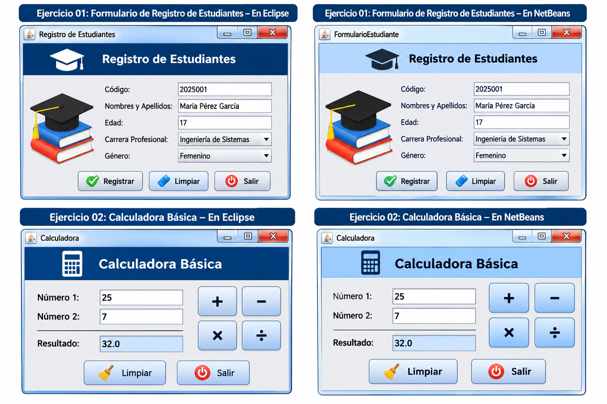

# LABORATORIO 09: INTRODUCCIÓN AL DESARROLLO DE INTERFACES GRÁFICAS CON JAVA SWING

**Curso:** Lenguaje de Programación I  
**Laboratorio:** 09  
**Tema:** Desarrollo de interfaces gráficas utilizando Java Swing  
**IDE principal:** Eclipse IDE  
**IDE complementario:** Apache NetBeans  
**Lenguaje:** Java

---

## 1. INTRODUCCIÓN

En este laboratorio se estudiará el desarrollo de interfaces gráficas de usuario (GUI) utilizando la biblioteca **Java Swing**, que forma parte de Java y permite construir aplicaciones de escritorio mediante ventanas, botones, etiquetas, cuadros de texto y otros componentes gráficos.

Se utilizará principalmente el entorno de desarrollo **Eclipse IDE**, donde los estudiantes aprenderán a crear proyectos Java, diseñar interfaces gráficas mediante código y programar eventos para interactuar con los componentes.

Paralelamente, el docente realizará una introducción práctica al entorno **Apache NetBeans**, enseñando paso a paso cómo desarrollar los mismos ejercicios, identificando las similitudes y diferencias entre ambos entornos.

El propósito es que el estudiante no dependa de un único IDE y pueda desarrollar aplicaciones Java Swing utilizando diferentes herramientas de desarrollo.

## 2. OBJETIVOS

### 2.1. Objetivo general

Desarrollar aplicaciones de escritorio utilizando Java Swing, aplicando componentes gráficos, administración de eventos y programación orientada a objetos mediante Eclipse IDE y Apache NetBeans.

### 2.2. Objetivos específicos

- Reconocer las características principales de Java Swing.
- Crear proyectos Java utilizando Eclipse IDE.
- Identificar y utilizar componentes gráficos como `JFrame`, `JPanel`, `JLabel`, `JTextField` y `JButton`.
- Implementar eventos mediante `ActionListener`.
- Construir interfaces gráficas utilizando código Java.
- Desarrollar aplicaciones equivalentes utilizando Apache NetBeans.
- Comparar los procedimientos de desarrollo en ambos entornos.

## 3. REQUISITOS PREVIOS

Antes de iniciar el laboratorio, el estudiante debe contar con:

- Conocimientos básicos de programación en Java.
- Conocimientos de clases, objetos y métodos.
- Conocimientos de constructores.
- Conocimientos básicos de programación orientada a objetos.
- Conocimientos sobre estructuras condicionales.
- JDK instalado y configurado.
- Eclipse IDE instalado.
- Apache NetBeans instalado.

## 4. FUNDAMENTOS DE JAVA SWING

Java Swing es una biblioteca que permite desarrollar interfaces gráficas de usuario para aplicaciones de escritorio.

### 4.1. Principales componentes

| Componente | Descripción |
|---|---|
| `JFrame` | Ventana principal de la aplicación. |
| `JPanel` | Contenedor de componentes gráficos. |
| `JLabel` | Muestra textos y etiquetas. |
| `JTextField` | Permite ingresar información en una línea. |
| `JTextArea` | Permite ingresar textos de varias líneas. |
| `JButton` | Representa un botón de acción. |
| `JComboBox` | Permite seleccionar opciones. |
| `JCheckBox` | Permite seleccionar opciones independientes. |
| `JRadioButton` | Permite seleccionar una opción entre varias. |
| `JOptionPane` | Permite mostrar cuadros de diálogo. |

### 4.2. Administración de eventos

Los eventos permiten que una aplicación responda a las acciones realizadas por el usuario.

Por ejemplo, cuando el usuario presiona un botón, se puede ejecutar un determinado procedimiento.

Se utilizará principalmente:

```java
button.addActionListener(e -> {
    // Código que se ejecutará al presionar el botón
});
```

## 5. DESARROLLO DEL LABORATORIO

El laboratorio comprende dos ejercicios prácticos.

Cada ejercicio se desarrollará utilizando Eclipse IDE y posteriormente se reproducirá utilizando Apache NetBeans.

---

# EJERCICIO 01: FORMULARIO DE REGISTRO DE ESTUDIANTES

## 1. Descripción

Desarrollar una aplicación de escritorio que permita registrar información básica de un estudiante mediante una interfaz gráfica utilizando Java Swing.

La aplicación deberá permitir ingresar los siguientes datos:

- Código del estudiante.
- Nombres y apellidos.
- Edad.
- Carrera profesional.
- Género.

La interfaz deberá contar con botones para registrar, limpiar y salir.

## 2. Componentes gráficos

Se deberán utilizar los siguientes componentes:

| Componente | Cantidad |
|---|---:|
| JFrame | 1 |
| JPanel | 1 o más |
| JLabel | 5 |
| JTextField | 3 |
| JComboBox | 2 |
| JButton | 3 |

## 3. Funcionalidades

**Botón Registrar:**

- Obtener los datos ingresados.
- Validar que los campos obligatorios no estén vacíos.
- Mostrar la información registrada mediante `JOptionPane`.

**Botón Limpiar:**

- Limpiar los campos de texto.
- Restablecer las opciones de selección.

**Botón Salir:**

- Finalizar la aplicación.

## 4. Desarrollo utilizando Eclipse IDE

### Paso 1. Crear un proyecto Java

1. Abrir Eclipse IDE.
2. Seleccionar `File`.
3. Seleccionar `New`.
4. Elegir `Java Project`.
5. Escribir como nombre del proyecto: `Laboratorio09_Ejercicio01`.
6. Presionar `Finish`.

### Paso 2. Crear el paquete

1. Ubicarse en la carpeta `src`.
2. Hacer clic derecho.
3. Seleccionar `New` → `Package`.
4. Escribir el nombre: `ejercicio01`.
5. Presionar `Finish`.

### Paso 3. Crear la clase principal

1. Hacer clic derecho sobre el paquete.
2. Seleccionar `New` → `Class`.
3. Escribir el nombre: `FormularioEstudiante`.
4. Marcar la opción para generar el método `public static void main(String[] args)`.
5. Presionar `Finish`.

### Paso 4. Diseñar la interfaz gráfica

Crear una clase que herede de `JFrame`.

Incorporar los componentes gráficos necesarios:

- Etiquetas (`JLabel`).
- Campos de texto (`JTextField`).
- Listas desplegables (`JComboBox`).
- Botones (`JButton`).

Utilizar un administrador de diseño (`Layout Manager`) para organizar los componentes.

### Paso 5. Programar los eventos

Implementar los eventos de los botones:

- Registrar.
- Limpiar.
- Salir.

### Paso 6. Ejecutar la aplicación

Ejecutar la clase principal y verificar que todos los componentes y eventos funcionen correctamente.

## 5. Desarrollo utilizando Apache NetBeans

El docente realizará el mismo ejercicio utilizando NetBeans.

### Paso 1. Crear un proyecto Java

1. Abrir Apache NetBeans.
2. Seleccionar `File` → `New Project`.
3. Elegir la categoría `Java`.
4. Seleccionar `Java Application`.
5. Asignar el nombre `Laboratorio09_Ejercicio01`.
6. Finalizar la creación del proyecto.

### Paso 2. Crear un JFrame Form

1. Ubicarse en el paquete del proyecto.
2. Hacer clic derecho.
3. Seleccionar `New` → `JFrame Form`.
4. Asignar el nombre `FormularioEstudiante`.
5. Presionar `Finish`.

### Paso 3. Diseñar la interfaz gráfica

1. Identificar la ventana de diseño (`Design`).
2. Ubicar la sección `Palette`.
3. Seleccionar los componentes Swing.
4. Arrastrar los componentes hacia el formulario.
5. Organizar los componentes mediante el diseñador visual.
6. Modificar las propiedades de cada componente.

### Paso 4. Programar los eventos

1. Seleccionar el botón Registrar.
2. Hacer doble clic sobre el botón.
3. Identificar el método de evento generado automáticamente.
4. Escribir el código correspondiente.
5. Repetir el procedimiento para los botones Limpiar y Salir.

### Paso 5. Ejecutar la aplicación

Presionar `Run Project` y comprobar el funcionamiento del formulario.

**Importante:** El estudiante deberá identificar cómo NetBeans genera automáticamente parte del código de la interfaz gráfica y compararlo con el procedimiento realizado en Eclipse.

---

# EJERCICIO 02: CALCULADORA BÁSICA UTILIZANDO JAVA SWING

## 1. Descripción

Desarrollar una aplicación de escritorio que permita realizar operaciones aritméticas básicas mediante una interfaz gráfica.

La aplicación deberá permitir ingresar dos números y seleccionar una operación matemática.

## 2. Operaciones

- Suma.
- Resta.
- Multiplicación.
- División.

## 3. Componentes gráficos

| Componente | Cantidad |
|---|---:|
| JFrame | 1 |
| JPanel | 1 o más |
| JLabel | 3 |
| JTextField | 3 |
| JButton | 6 |

Los botones deberán representar las cuatro operaciones matemáticas, además de las opciones Limpiar y Salir.

## 4. Funcionalidades

**Operaciones matemáticas:**

- Leer los dos valores ingresados.
- Convertir los valores de texto a números.
- Ejecutar la operación seleccionada.
- Mostrar el resultado en el campo correspondiente.

**Validaciones:**

- Verificar que los campos no estén vacíos.
- Controlar que los valores ingresados sean numéricos.
- Evitar la división entre cero.
- Mostrar mensajes de error mediante `JOptionPane`.

**Botón Limpiar:**

Restablecer los campos de la calculadora.

**Botón Salir:**

Cerrar la aplicación.

## 5. Desarrollo utilizando Eclipse IDE

### Paso 1. Crear el proyecto

1. Seleccionar `File` → `New` → `Java Project`.
2. Asignar el nombre `Laboratorio09_Ejercicio02`.
3. Presionar `Finish`.

### Paso 2. Crear el paquete

Crear el paquete `ejercicio02` dentro de `src`.

### Paso 3. Crear la clase principal

Crear la clase `Calculadora` e implementar el método `main`.

### Paso 4. Construir la interfaz gráfica

Crear una clase que herede de `JFrame`.

Incorporar:

- Dos campos de entrada para los números.
- Un campo para mostrar el resultado.
- Cuatro botones para las operaciones.
- Un botón para limpiar.
- Un botón para salir.

### Paso 5. Programar las operaciones

Implementar los eventos de cada botón utilizando `ActionListener`.

Aplicar las conversiones necesarias para trabajar con valores numéricos.

### Paso 6. Realizar las validaciones

Controlar los errores de ingreso de datos y la división entre cero.

### Paso 7. Ejecutar y probar

Realizar pruebas con diferentes valores para verificar los resultados de las operaciones.

## 6. Desarrollo utilizando Apache NetBeans

### Paso 1. Crear el proyecto

1. Seleccionar `File` → `New Project`.
2. Elegir `Java Application`.
3. Asignar el nombre `Laboratorio09_Ejercicio02`.
4. Finalizar la creación.

### Paso 2. Crear el formulario

1. Hacer clic derecho sobre el paquete.
2. Seleccionar `New` → `JFrame Form`.
3. Asignar el nombre `Calculadora`.

### Paso 3. Diseñar la interfaz

1. Ingresar a la pestaña `Design`.
2. Utilizar la sección `Palette`.
3. Arrastrar los componentes necesarios.
4. Organizar los campos de entrada y los botones.
5. Modificar las propiedades de los componentes.

### Paso 4. Implementar los eventos

1. Hacer doble clic sobre cada botón.
2. Identificar el método de evento generado.
3. Implementar la operación matemática correspondiente.
4. Agregar las validaciones.
5. Implementar los botones Limpiar y Salir.

### Paso 5. Ejecutar y probar

Ejecutar el proyecto y comprobar el funcionamiento de las cuatro operaciones.

---

## 6. COMPARACIÓN ENTRE ECLIPSE Y NETBEANS

Al finalizar los dos ejercicios, el estudiante deberá identificar las diferencias y similitudes entre ambos entornos de desarrollo.

| Característica | Eclipse | NetBeans |
|---|---|---|
| Creación de proyectos | Java Project | Java Application |
| Creación de ventanas | Mediante código Java | JFrame Form o mediante código |
| Diseño visual | Requiere herramientas adicionales o programación manual | Incluye diseñador visual Swing |
| Componentes Swing | Se incorporan mediante código | Se pueden arrastrar desde Palette |
| Programación de eventos | Mediante listeners | Mediante listeners y generación de eventos |
| Ejecución | Run As → Java Application | Run Project |

## 7. ACTIVIDADES PROPUESTAS AL ESTUDIANTE

Después de completar los dos ejercicios, realizar las siguientes actividades:

1. Modificar el formulario de registro para agregar un campo de correo electrónico.
2. Incorporar una validación para impedir que se registre una edad negativa.
3. Modificar la calculadora para permitir realizar operaciones con números decimales.
4. Agregar un botón que permita calcular el porcentaje de un número.
5. Personalizar los formularios utilizando colores, fuentes y títulos.
6. Implementar mensajes de confirmación antes de cerrar las aplicaciones.

## 8. ENTREGABLES

El estudiante deberá presentar:

- Proyecto Java del Ejercicio 01 desarrollado en Eclipse.
- Proyecto Java del Ejercicio 02 desarrollado en Eclipse.
- Proyecto Java del Ejercicio 01 desarrollado en NetBeans.
- Proyecto Java del Ejercicio 02 desarrollado en NetBeans.
- Capturas de pantalla de las interfaces gráficas.
- Evidencias del funcionamiento de los eventos.
- Archivo README.md con una breve explicación de los ejercicios desarrollados.

## 9. ESTRUCTURA SUGERIDA DEL REPOSITORIO

```text
Laboratorio09-Java-Swing/
│
├── README.md
│
├── Eclipse/
│   ├── Laboratorio09_Ejercicio01/
│   └── Laboratorio09_Ejercicio02/
│
├── NetBeans/
│   ├── Laboratorio09_Ejercicio01/
│   └── Laboratorio09_Ejercicio02/
│
└── Evidencias/
    ├── Ejercicio01/
    └── Ejercicio02/
```



## 10. CRITERIOS DE EVALUACIÓN

| Criterio | Puntaje |
|---|---:|
| Creación y configuración de proyectos en Eclipse y NetBeans | 2 |
| Diseño de la interfaz gráfica del ejercicio 01 | 3 |
| Implementación de eventos del ejercicio 01 | 3 |
| Diseño de la interfaz gráfica del ejercicio 02 | 3 |
| Implementación de operaciones y validaciones del ejercicio 02 | 4 |
| Funcionamiento de las aplicaciones en ambos IDE | 3 |
| Presentación de evidencias y repositorio | 2 |
| **TOTAL** | **20** |

## 11. CONCLUSIONES

Al finalizar el laboratorio, el estudiante estará en capacidad de:

- Desarrollar aplicaciones de escritorio utilizando Java Swing.
- Construir interfaces gráficas mediante componentes visuales.
- Implementar eventos para interactuar con el usuario.
- Aplicar validaciones en formularios.
- Desarrollar aplicaciones Java utilizando Eclipse y Apache NetBeans.
- Reconocer que la lógica de programación Java es independiente del entorno de desarrollo utilizado.

---

**LABORATORIO 09 – LENGUAJE DE PROGRAMACIÓN I**

*Aprendiendo Java mediante el desarrollo práctico de aplicaciones gráficas.*
